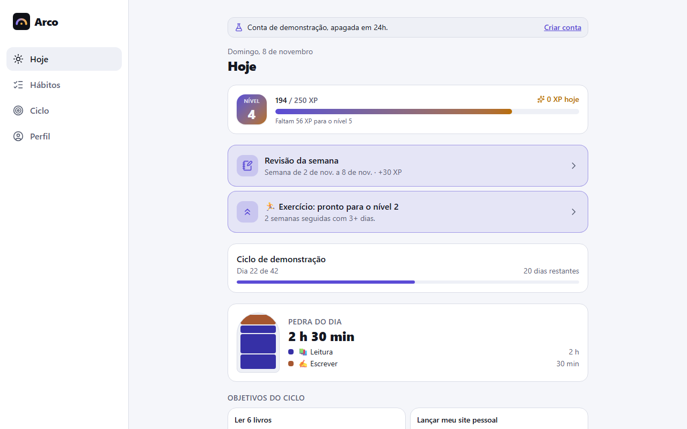
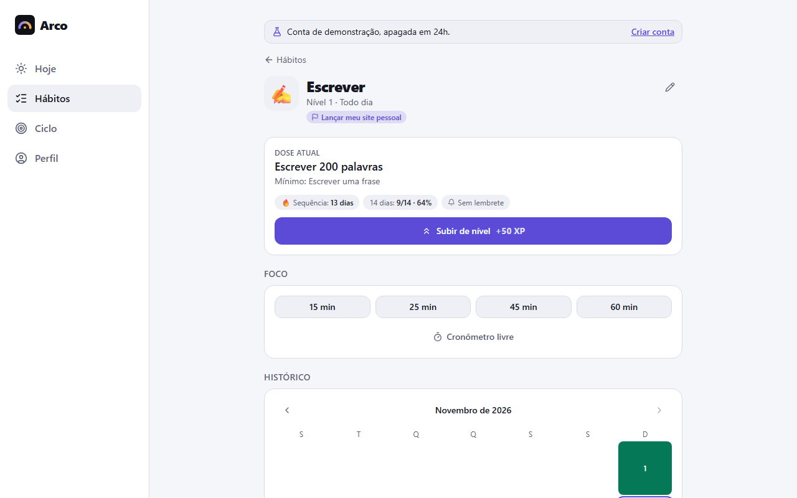
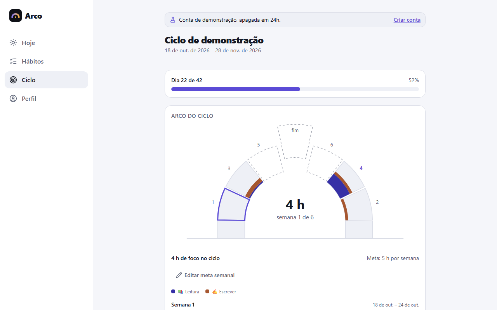
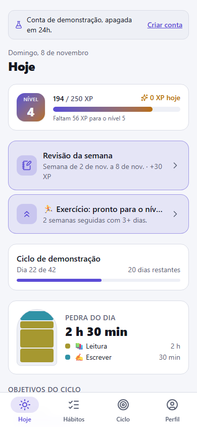
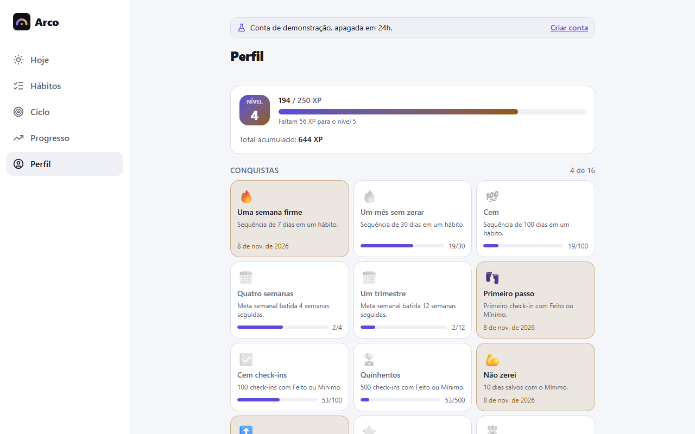
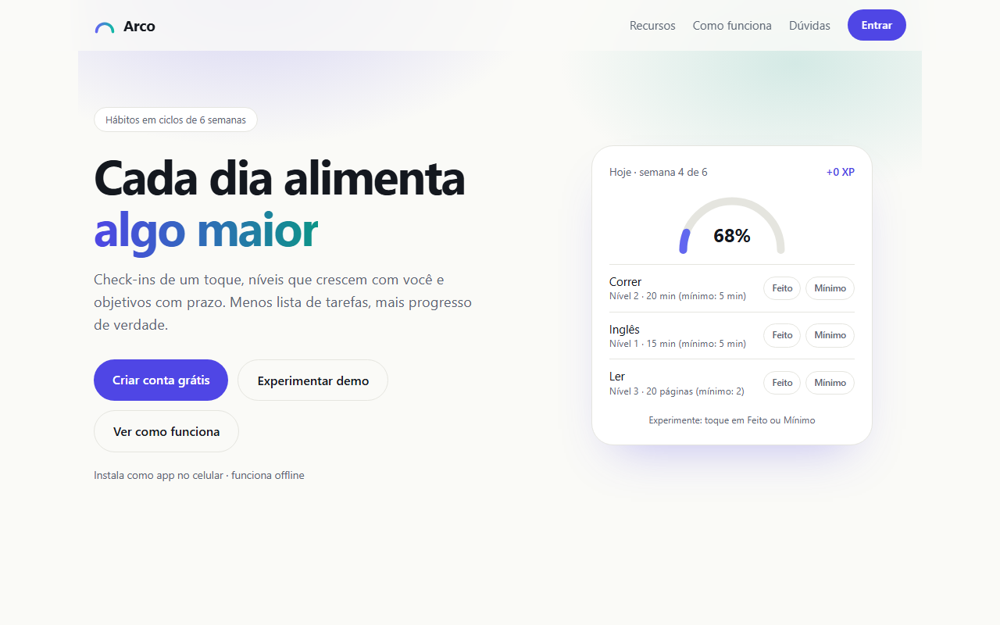
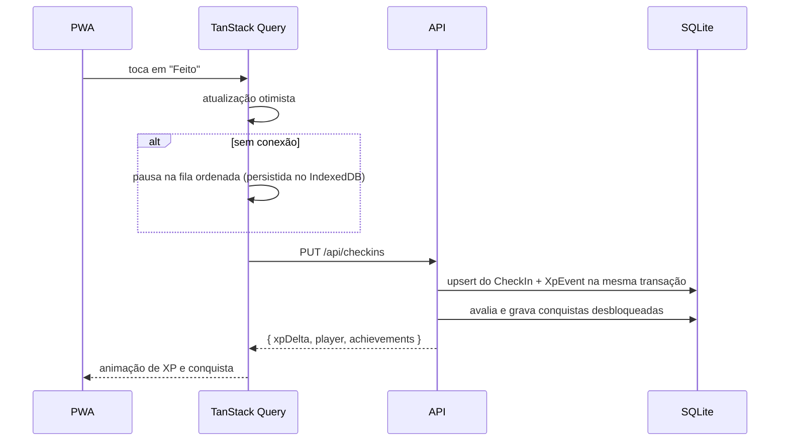
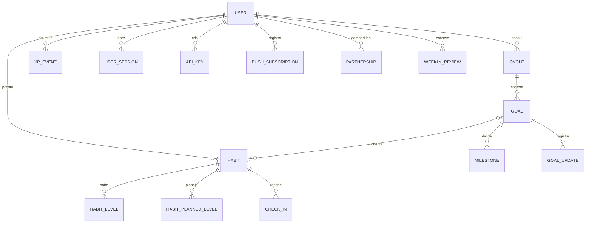
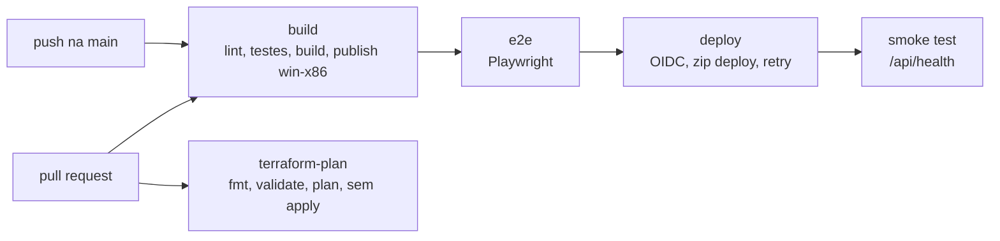

# Arco

App de hábitos com **progresso e objetivo**: check-ins diários alimentam hábitos com níveis, os hábitos servem a objetivos
com prazo e tudo vive em ciclos de 6 semanas, com XP e nível de jogador. PWA instalável, offline para o dia a dia,
multiusuário e operável inteiro pela API e por assistentes de IA via MCP.

- **Demo ao vivo:** https://arco.daviluis.dev (botão "Experimentar demo", sem cadastro)
<!-- Badge do Azure DevOps: ativar quando o pipeline existir (trocar ORG e PROJETO).
[](https://dev.azure.com/ORG/PROJETO/_build/latest?definitionId=1&branchName=main)
-->
- **API interativa (Scalar):** https://arco.daviluis.dev/api/docs · OpenAPI em `/api/openapi/v1.json`

| Hoje | Hábito | Ciclo |
|---|---|---|
|  |  |  |

| Hoje (mobile) | Perfil | Landing |
|---|---|---|
|  |  |  |

## Visão técnica

Projeto full-stack de ponta a ponta, em produção, feito para exercitar problemas que aparecem em sistemas reais: isolamento
multi-tenant, autenticação forte, cobrança recorrente, entrega assíncrona confiável, operação offline, observabilidade e
infraestrutura como código.

| Área | O que foi implementado |
|---|---|
| **Backend** | .NET 10, Minimal APIs em *vertical slices*, EF Core 10 com SQLite em modo WAL, regras de negócio em funções puras |
| **Multi-tenancy** | Isolamento por linha com *global query filters* do EF Core e `CurrentUser` por requisição |
| **Autenticação** | Cookie com sessão revogável por aparelho, Google OAuth, 2FA TOTP (RFC 6238), chaves de API, *rate limiting* por IP |
| **Pagamentos** | Stripe Checkout e Customer Portal, com webhook assinado e idempotente |
| **Confiabilidade** | *Transactional outbox*, retry com *exponential backoff* e *jitter*, *circuit breaker* por host, consumidor idempotente |
| **Mensageria** | `IEventBus` com implementação em memória e Azure Service Bus |
| **Frontend** | React 19, TypeScript, TanStack Query, PWA com Workbox, cache em IndexedDB e fila de mutações offline |
| **Web Push** | VAPID (RFC 8292) e criptografia `aes128gcm` (RFC 8291) implementados sem biblioteca externa |
| **Integração com IA** | Servidor MCP (*Model Context Protocol*) com 24 ferramentas sobre a própria API REST |
| **Observabilidade** | Sentry, OpenTelemetry e Application Insights: traces, métricas customizadas e logs, sem dados pessoais |
| **Infraestrutura** | Terraform (azurerm), state remoto, Key Vault com RBAC e managed identity, GitHub Actions com OIDC, sem segredos de longa duração |
| **Qualidade** | 243 testes de domínio e integração, 11 cenários E2E com Playwright, E2E como condição para o deploy |

Em números: cerca de 8 mil linhas de C# na API, 12 mil de TypeScript no web e 5 mil de testes; 23 entidades, 11 migrations e
23 fatias de funcionalidade.


## Funcionalidades

- **Hábitos com níveis:** cada nível tem uma dose ("25 min") e uma versão mínima ("5 min"). Dá para planejar a
  escada à frente e escolher quando o app sugere subir e quando sugere voltar um degrau.
- **Check-in** Feito / Mínimo / Não fiz, com XP; sequências (streaks) com tolerância a uma falha isolada por semana.
- **Ciclos e objetivos:** ciclos de ~6 semanas com objetivos numéricos ou por marcos, e encerramento com revisão guiada.
- **Revisão semanal**, **conquistas**, **histórico**, **estatísticas** e sessões de **foco**.
- **Lembretes push** por hábito e da revisão semanal.
- **Offline:** telas com os últimos dados e fila de check-ins enviada quando a conexão volta.
- **Planos Free e Pro** com Stripe (limites de hábitos, chaves de API e MCP; temas do perfil no Pro).
- **Perfil público** em `/u/<slug>` com prévia social (imagem Open Graph gerada no servidor).
- **Parceiro de responsabilidade:** convite por link; o parceiro vê o resumo semanal e é avisado quando a semana fecha (push ou e-mail).
- **Conta:** e-mail e senha ou Google, 2FA (TOTP) com códigos de recuperação, sessões por aparelho, onboarding.
- **pt-BR e inglês** (app, e-mails e notificações).
- **Admin:** métricas agregadas (cadastros, ativos, retenção por coorte).
- **Backup** diário no servidor (14 dias) e exportação JSON no Perfil.
- **API e MCP:** tudo pela API REST com chave de API, mais um servidor MCP para assistentes de IA.

O conceito e as regras (XP, sugestões, sequências, planos) estão em [docs/PRODUCT.md](docs/PRODUCT.md).

## Regras de domínio

As regras ficam em `src/Arco.Api/Domain`, como funções puras sem acesso a banco ou relógio, o que permite testá-las
isoladamente. A especificação completa está em [docs/PRODUCT.md](docs/PRODUCT.md).

**Hierarquia:** Ciclo (2 a 12 semanas, padrão 6) → Objetivo (numérico ou por marcos, com prazo) → Hábito (com níveis) → Check-in diário.

| Evento | XP |
|---|---|
| Check-in "Feito" | `10 + 2 × (nível do hábito − 1)` |
| Check-in "Mínimo" | Metade do "Feito", arredondada para baixo |
| Subir de nível um hábito | 50 |
| Concluir um marco | 25 |
| Concluir um objetivo | 150 |
| Encerrar um ciclo | 100 |
| Fazer a revisão semanal | 30 |

- **Nível do jogador:** o custo para avançar é `100 + 50 × (nível − 1)`, e o nível é sempre derivado da soma do livro-razão.
- **Sugestão de subir:** por padrão, consistência de pelo menos 80% em 14 dias, contando só "Feito", porque o "Mínimo" mantém o
  hábito vivo, mas não prova que a dose ficou fácil. A alternativa configurável por hábito é "N semanas seguidas com X dias".
  A decisão é sempre manual; "Agora não" adia por 7 dias.
- **Sugestão de voltar:** duas semanas terminadas seguidas abaixo da metade da meta semanal.
- **Sequências com tolerância:** calculadas a partir do histórico, nunca armazenadas. Uma falha isolada por semana é perdoada;
  duas seguidas, ou duas na mesma semana, zeram a sequência.
- **Conquistas:** catálogo de 16 medalhas, desbloqueadas pelo próprio uso. Desfazer um check-in não as retira; excluir um ciclo ou objetivo retira as que deixaram de valer.
- **Tempo:** "hoje" é calculado no fuso do usuário. A semana da meta semanal começa na segunda, e os dias da semana seguem 0 = domingo.


## Arquitetura


O sistema é um **monólito modular**, em um único processo, de propósito: para o volume do projeto, um deploy simples e transações
locais valem mais do que a complexidade operacional de serviços distribuídos. As fronteiras internas, como `IEventBus`, `IEmailSender` e
`IPushSender`, permitem trocar implementações sem mudar as regras de negócio.

### Fluxo de um check-in



O XP é sempre recalculado no servidor, então um check-in reenviado pela fila não concede pontos em dobro: há um índice único por `(HabitId, Date)`.

### Modelo de dados (principais entidades)



Restrições importantes ficam no próprio banco: um **índice único parcial** garante no máximo um ciclo ativo por usuário, e índices
únicos evitam revisão semanal, lembrete ou check-in duplicados mesmo sob concorrência.


## Stack

| Camada | Tecnologia | Por quê |
|---|---|---|
| API | .NET 10, Minimal APIs, *vertical slices* | Cada funcionalidade fica em uma pasta, sem camadas de repositório ou mediator sem necessidade |
| Dados | EF Core 10, SQLite (WAL), Dapper nos relatórios | Banco embutido, com backup consistente por `VACUUM INTO`; SQL à mão só onde agrega |
| Frontend | React 19, TypeScript, Vite, React Router 7, Tailwind v4 | Tipagem de ponta a ponta com um cliente espelho do contrato |
| Estado remoto | TanStack Query | Cache, atualização otimista e persistência offline em uma só camada |
| PWA | vite-plugin-pwa, Workbox (`injectManifest`) | Service worker próprio para push e precache controlado |
| i18n | i18next, pt-BR e en | Inclui e-mails e notificações, no idioma de cada usuário |
| Integrações | Stripe, Resend, Google OAuth, SkiaSharp | Cobrança, e-mail, login social e imagem Open Graph no servidor |
| Observabilidade | Sentry, OpenTelemetry, Application Insights | Erros no back e no front, com traces e métricas da API |
| Resiliência | `Microsoft.Extensions.Http.Resilience` (Polly) | Retry, timeout e circuit breaker declarativos |
| Mensageria | Azure Service Bus (opcional) | Ativado só com connection string |
| Infraestrutura | Azure App Service, Terraform, Key Vault, Cloudflare | Ambiente reproduzível, com segredos fora do código |
| CI/CD | GitHub Actions com OIDC, Azure Pipelines | Deploy sem credencial armazenada |

Em produção há um único processo: o ASP.NET serve a API (`/api/*`) e o build do frontend (`wwwroot`).

```
src/Arco.Api/
  Domain/           regras puras e testáveis (XP, níveis, frequência, sequências, sugestões, conquistas)
  Features/<Nome>/  endpoint e lógica de cada funcionalidade (hábitos, check-ins, ciclos, MCP…)
  Infrastructure/   DbContext e migrations, relógio, autenticação (cookie e chave de API), push, backup,
                    outbox, eventos, resiliência e telemetria
tests/Arco.Api.Tests/  testes de domínio e de integração (WebApplicationFactory + SQLite temporário)
web/src/
  api/              cliente tipado, espelho de docs/API.md
  features/         lógica por domínio (check-in offline, hábitos, XP, estatísticas…)
  components/ui/    primitivas visuais
  pages/            telas (Hoje, Hábitos, Ciclo, Perfil, Estatísticas, Revisão, Login, Onboarding, Admin, Parceiro)
infra/              Terraform do Azure
docs/               produto, contrato da API e deploy
```

## Segurança

- **Isolamento entre contas:** entidades `IUserOwned` recebem um *global query filter* do EF Core, e novas linhas são carimbadas com o dono
  ao salvar. Esquecer um `Where` não vaza dados. `IgnoreQueryFilters()` só aparece em consultas intencionalmente globais.
- **Senhas:** bcrypt com fator de custo 11. O login verifica um hash fictício quando o e-mail não existe, para que o tempo de resposta não revele quais contas existem.
- **Sessões:** cookie `HttpOnly`, `Secure` e `SameSite=Lax`, ligado a uma linha em `UserSessions`. Isso permite listar aparelhos e encerrar
  sessões remotamente, e trocar a senha invalida as demais.
- **2FA:** TOTP (RFC 6238, HMAC-SHA1, 6 dígitos, janela de ±1 passo), com segredo cifrado por ASP.NET DataProtection e 10 códigos de recuperação guardados apenas como SHA-256.
- **Chaves de API:** exibidas uma única vez e guardadas só como SHA-256; ações sensíveis, como trocar a senha e excluir a conta, exigem o cookie.
- ***Rate limiting*:** janela fixa por IP, 5 tentativas de login e 10 ações de conta por minuto, respondendo `429` no formato padrão de erro.
- **Stripe:** webhook com verificação de assinatura e deduplicação por `event.id` na mesma transação da mudança de plano.
- **Tokens de e-mail** (verificação e redefinição) são guardados apenas como hash.
- **Headers:** `X-Content-Type-Options: nosniff`, `X-Frame-Options: DENY` e `Referrer-Policy: strict-origin-when-cross-origin`.
- **Segredos de produção:** ficam no Azure Key Vault, lidos pela managed identity do App Service. O GitHub Actions autentica no Azure com
  *federated credentials* (OIDC), sem senha armazenada, e cada identidade tem o menor escopo necessário.

## Confiabilidade

**Transactional outbox.** Enviar um e-mail depois de salvar no banco tem duas falhas clássicas: o e-mail sai e o `SaveChanges` falha, ou o
oposto. Aqui, a mensagem é gravada em `OutboxMessages` **na mesma transação** da ação, e a entrega acontece depois.

- E-mails são tentados logo após o `SaveChanges`, para o usuário não esperar; um *hosted service* varre o que ficou pendente a cada 30 s.
- *Claim* atômico com `UPDATE ... WHERE LockedUntil IS NULL OR LockedUntil < now` e *lease* de 5 minutos, que impede envio duplo.
- *Backoff* de 1 min, 5 min, 30 min, 2 h e 12 h, com desistência após 6 tentativas.
- O payload é apagado após o envio, porque pode conter o link de redefinição de senha. Os registros são removidos depois de 30 dias.
- O `Idempotency-Key` enviado ao Resend evita duplicidade se a resposta se perder depois de o e-mail ter sido aceito.

**Evento de domínio.** Concluir a revisão semanal grava `WeekClosed` no outbox; o worker publica no `IEventBus` e o consumidor avisa cada
parceiro aceito, sem atrasar a resposta da revisão. A deduplicação usa uma chave única por parceiro e semana, tornando a reentrega segura, o que é necessário porque filas garantem entrega *at-least-once*.

**Clientes HTTP resilientes.** Push e e-mail usam `AddStandardResilienceHandler` com timeout de 8 s por tentativa e 25 s no total, 3 retentativas
com *exponential backoff* e *jitter*, e um *circuit breaker* **por host** (janela de 60 s, mínimo de 8 chamadas, 50% de falha, 30 s aberto), já que FCM,
Apple e Mozilla falham de forma independente. Respostas 404/410 indicam inscrição morta: removem a inscrição, sem retentar nem contar para o circuito.

**Jobs de fundo** não têm `HttpContext`: cada usuário é processado em um escopo próprio com `CurrentUser.Impersonate(id)`, de modo que a falha de um não afeta os demais.

**Backup:** cópia diária com `VACUUM INTO`, consistente mesmo com o app em uso, com retenção de 14 dias.

## Observabilidade

- **Sentry** no backend e no React para erros, com `BeforeSend` removendo cookies, headers e outros dados da requisição.
- **OpenTelemetry com Application Insights:** ativado apenas com `APPLICATIONINSIGHTS_CONNECTION_STRING`. Traces de requisição, HttpClient e EF Core, além de
  spans próprios em lembretes e envio de e-mail.
- **Métricas de negócio:** `arco.checkins.created`, `arco.push.sent`, `arco.push.failed` e `arco.plan_limit.blocked`.
- **Privacidade por padrão:** um `BaseProcessor<Activity>` remove `url.query`, `client.address`, `user_agent.original`, `enduser.*` e o texto de SQL antes da exportação. A ausência desses dados foi conferida em consultas KQL sobre a telemetria de produção.

## PWA e offline

- O cache do TanStack Query é persistido no **IndexedDB**, e as telas abrem com os últimos dados sem rede. O service worker **nunca** cacheia `/api`, evitando duas fontes de verdade.
- **Check-in offline:** a mutação pausa sem rede, em uma fila ordenada por `scope`; ao reabrir o app, as mutações são retomadas na ordem. As demais ações usam `networkMode: 'always'` e falham na hora, com mensagem clara.
- O app distingue `isLoadingError` de `isError`, para que uma falha de atualização não substitua dados em cache por uma tela de erro.
- **Push:** VAPID e criptografia `aes128gcm` feitos sobre `System.Security.Cryptography`. Uma tabela de despacho com chave única garante no máximo um envio por lembrete, e inscrições com 10 falhas seguidas são removidas.
- Uma mudança incompatível no formato das respostas troca o `buster`, invalidando o cache persistido.


## Desenvolvimento

Requisitos: .NET 10 SDK e Node 24.

```bash
dotnet run --project src/Arco.Api    # API em http://localhost:5080
cd web && npm install && npm run dev  # app em http://localhost:5173 (proxy de /api para :5080)
```

- Crie uma conta em `/register` ou use "Experimentar demo". Sem `Email:ResendApiKey`, os e-mails saem no log da API.
- O service worker (offline e push) não roda no `npm run dev`. Para testar, use `npm run build && npm run preview`
  (http://localhost:4173, com o mesmo proxy).
- Se o `npm install` pular as devDependencies (por `NODE_ENV=production` na máquina), use `npm install --include=dev`.
- Os ícones do PWA saem de `web/public/icon*.svg`: `npm run icons` regera os PNGs.

Testes e verificação:

```bash
dotnet test                              # backend: domínio e integração
cd web && npm run lint && npm run build  # frontend: oxlint e build com checagem de tipos
cd web && npx playwright install chromium && npm run e2e   # E2E (Playwright)
cd web && npm run screenshots            # regera docs/images
```

Os testes de integração usam `WebApplicationFactory` com SQLite temporário e relógio controlável. O E2E publica a API
numa pasta temporária (porta 5199) e o preview do web (porta 4199); `E2E_API_PORT` e `E2E_WEB_PORT` trocam as portas, para
rodar execuções simultâneas.

**Estratégia de testes:**

- **Domínio:** testes unitários sobre as funções puras (XP, níveis, sequências, sugestões, calendário).
- **Integração:** a API real sobre `WebApplicationFactory`, com SQLite descartável por teste, relógio controlável (`TimeProvider`) e fakes apenas nas fronteiras externas (e-mail e push). Incluem isolamento entre contas, webhooks do Stripe assinados, MCP de ponta a ponta e resiliência com handler HTTP falso.
- **E2E:** Playwright sobre o build de produção, cobrindo cadastro, onboarding, 2FA com TOTP gerado no teste, sessões em navegadores separados, convite de parceiro, limite de plano e troca de idioma.
- O deploy depende de build, testes e E2E passarem.


Nova migration (aplicada sozinha na inicialização; se falhar, o app não sobe):

```bash
dotnet tool restore
dotnet tool run dotnet-ef migrations add <Nome> --project src/Arco.Api --output-dir Infrastructure/Migrations
```

Hash da senha de produção: `dotnet run --project src/Arco.Api -- hash-password "sua-senha"`.

## Decisões técnicas

- **Filtro global por usuário:** entidades `IUserOwned` têm filtro de query via `CurrentUser`; jobs de fundo usam
  `CurrentUser.Impersonate(id)` e `IgnoreQueryFilters()` só em leituras cruzadas intencionais. Esquecer um `Where` não vaza dados.
- **XP como livro-razão:** cada ação grava um `XpEvent` na mesma transação; excluir algo remove os eventos e revoga conquistas.
  O nível sai da soma, nunca de um contador.
- **Web Push sem dependência:** VAPID e criptografia `aes128gcm` implementados em `Infrastructure/Push`; os lembretes rodam num hosted service.
- **Offline com fila:** o cache do TanStack Query é persistido no IndexedDB e os check-ins pausam numa fila ordenada, retomada ao reabrir; o servidor recalcula o XP.
- **MCP:** `/api/mcp` expõe ferramentas que chamam a própria API REST (nunca o banco), então valem as mesmas regras e limites de plano.
- **TOTP próprio:** 2FA (RFC 6238) com segredo cifrado por DataProtection e códigos de recuperação guardados só como SHA-256, sem pacote externo.
- **Origem pública atrás do Cloudflare:** `App:BaseUrl` fixa a origem de toda requisição em produção, mantendo estáveis o redirect_uri do Google e os links dos e-mails.
- **Outbox transacional:** e-mails e eventos são gravados no mesmo `SaveChanges` da ação; um worker entrega com retry, backoff e lease, e o payload é apagado após o envio, porque pode conter token.
- **Resiliência por host:** retry, timeout e circuit breaker nos clientes de push e e-mail, com um circuito por host; 404/410 de push significam inscrição morta e nunca entram em retry.
- **Evento atrás de interface:** `WeekClosed` passa pelo `IEventBus`, em memória por padrão ou Azure Service Bus só com connection string; o consumidor é idempotente.
- **Dapper só em relatório:** as métricas do admin, que cruzam usuários de propósito, usam SQL com Dapper; o resto continua no EF para não perder o filtro por usuário.
- **Telemetria sem dados pessoais:** só liga com a connection string; query string, IP, user agent e texto de SQL são removidos antes de exportar.
- **Datas:** "hoje" vem do fuso do usuário, nunca de `DateTime.UtcNow`; datas de calendário são `DateOnly`.

## Problemas reais resolvidos

Alguns diagnósticos feitos com o sistema já em produção:

- **Deploy intermitente com erro 500.** O `azure/webapps-deploy` falhava sem mensagem útil. O trace do Kudu revelou `There is not enough space on the disk`: o plano gratuito não comportava
  o envio, e 94 MB do pacote de 232 MB eram símbolos de depuração nativos do SkiaSharp (`libSkiaSharp.pdb`). Removidos do publish por um target de MSBuild, o pacote caiu para 138 MB.
- **Cancelamento invisível no Stripe.** Um teste automatizado do fluxo completo em produção, com checkout real em modo de teste, mostrou que, nas versões atuais da API, o Customer Portal define `cancel_at` e mantém `cancel_at_period_end` como `false`. O app continuava exibindo "renova em". Os testes de integração passavam porque usavam o formato antigo do evento.
- **`terraform plan` evitou derrubar outro sistema.** O plano do App Service é compartilhado com outro projeto e fica em outro grupo de recursos. O código inicial o recriaria; a revisão levou a referenciá-lo apenas pelo ID, o que também dispensou dar à identidade de CI qualquer acesso àquele grupo.
- **Migração de segredos sem indisponibilidade.** Como o Terraform oculta os valores no diff, o `plan` em JSON foi comparado programaticamente com o estado real antes do `apply`. A troca para Key Vault começou por um segredo não crítico, como *canary*, com reversão automática se o Azure não resolvesse as referências.
- **Origem instável atrás do Cloudflare.** O `Host` recebido alternava entre o domínio próprio e o `*.azurewebsites.net`, quebrando o `redirect_uri` do Google. `App:BaseUrl` passou a definir a origem pública em produção.


## API e MCP

Tudo o que o app faz passa pela API REST documentada em [docs/API.md](docs/API.md). Fora do app, autentique com
uma chave de API, criada em **Perfil → Acesso pela API** (ela aparece uma única vez):

```bash
curl -H "Authorization: Bearer arco_..." https://arco.daviluis.dev/api/today
```

O servidor MCP fica em `/api/mcp`, com a mesma chave. Para conectar no Claude Code:

```bash
claude mcp add --transport http arco https://arco.daviluis.dev/api/mcp --header "Authorization: Bearer arco_..."
```

## Deploy

**Azure App Service (plano Free):** publicado em `https://arco.daviluis.dev` (proxy do domínio do Azure). A esteira do GitHub Actions testa e publica a cada push na `main`. A configuração
única (Web App, identidade OIDC, segredos), os limites do plano, o backup e o monitor de disponibilidade estão em
[docs/DEPLOY.md](docs/DEPLOY.md).

**Infraestrutura como código:** o ambiente do Azure está descrito em [`infra/`](infra/) com Terraform, com state remoto e segredos no Key
Vault (o código só guarda referências). O `apply` é sempre manual; cada pull request roda um `terraform plan`. O passo a passo está em
[infra/IMPORT.md](infra/IMPORT.md).



O runtime do .NET 10 é publicado junto (*self-contained*, `win-x86`), porque o plano gratuito roda em 32 bits. Banco, chaves do DataProtection e chaves VAPID ficam em
`D:\home\data`, fora do pacote, e sobrevivem aos deploys. As migrations são aplicadas na inicialização.


**Servidor próprio (Docker):** requer uma VPS com Docker e um domínio apontando para ela (HTTPS é obrigatório para o
PWA e o push).

1. Copie `.env.example` para `.env` e preencha `ARCO_DOMAIN`, `ARCO_PASSWORD_HASH` (entre aspas simples) e
   `ARCO_PUSH_SUBJECT`.
2. Rode `docker compose up -d --build`.

O Caddy emite o certificado. O banco, as cópias de backup e as chaves ficam no volume `arco-data` (`/data`). Para
copiar o banco à mão:

```bash
docker compose cp arco:/data/arco.db ./backup.db
```

## Documentação

- [docs/PRODUCT.md](docs/PRODUCT.md): conceito, regras, pendências e próximos passos.
- [docs/API.md](docs/API.md): contrato da API (mantido a cada mudança).
- [docs/DEPLOY.md](docs/DEPLOY.md): deploy no Azure, Stripe, Sentry, backup e restauração.
- [docs/repo_map.md](docs/repo_map.md): mapa do repositório.
- [docs/RELATO-AZURE.md](docs/RELATO-AZURE.md): como foi montar a esteira no Azure.
- [infra/IMPORT.md](infra/IMPORT.md): importar o ambiente para o Terraform.
- [CLAUDE.md](CLAUDE.md): convenções para quem (ou o que) mexe no código.

## Licença

Distribuído sob a licença MIT. Veja [LICENSE](LICENSE).

## Segurança

Para reportar vulnerabilidades, veja [SECURITY.md](SECURITY.md).
