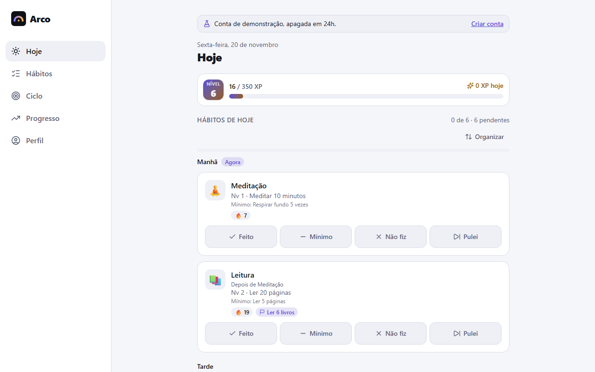
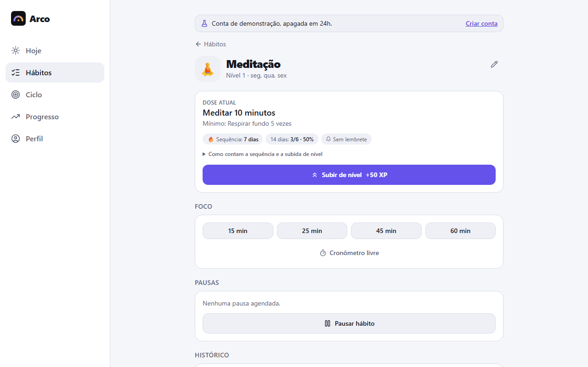
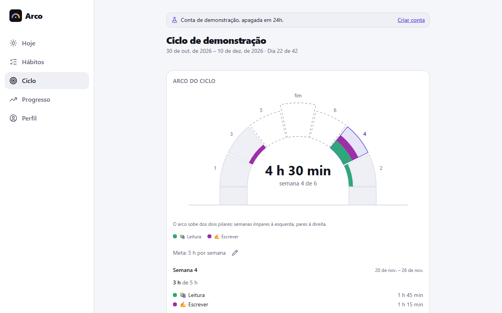
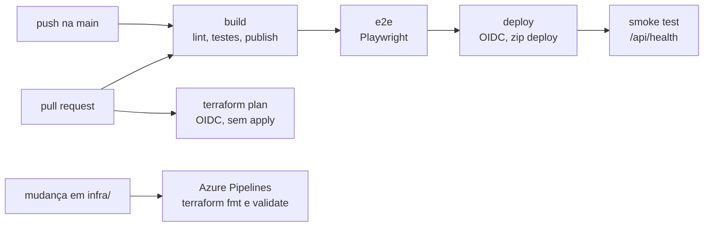

# Arco

App de hábitos em que a dose **cresce com você**: cada hábito tem níveis, cada nível tem uma versão mínima para os dias
ruins, e o app só sugere subir quando o histórico mostra que a dose atual ficou fácil.

[](https://dev.azure.com/naktiwru/arco/_build/latest?definitionId=1&branchName=main)

- **Demo ao vivo:** https://arco.daviluis.dev (botão "Experimentar demo", sem cadastro)
- **API interativa (Scalar):** https://arco.daviluis.dev/api/docs · OpenAPI em `/api/openapi/v1.json`

| Hoje | Hábito | Ciclo |
|---|---|---|
|  |  |  |

## Por que existe

Apps de hábito costumam tratar todo dia como igual: ou você fez, ou quebrou a sequência. Na prática, o que derruba um
hábito é a dose errada (grande demais no começo, pequena demais depois) e o dia ruim que zera tudo.

O Arco foi feito para resolver isso no meu próprio uso, e é o app que abro todos os dias desde outubro de 2026:

- **Níveis com escada planejada.** "Inglês: 15 → 25 → 35 → 45 → 60 min". Subir é uma decisão manual; o app apenas sugere,
  com uma regra escolhida por hábito (80% de consistência em 14 dias, ou N semanas seguidas com X dias).
- **Versão mínima.** Cada nível tem um mínimo ("10 min") que mantém o hábito vivo no dia difícil. Conta para a sequência,
  mas não para a sugestão de subir: fazer o mínimo não prova que a dose ficou fácil.
- **Sequência com tolerância.** Uma falha isolada por semana é perdoada; duas seguidas zeram.
- **Voltar um degrau também é sugerido**, depois de duas semanas abaixo da metade da meta.
- **Ciclos de 6 semanas** com objetivos de prazo, revisão semanal e revisão de fim de ciclo.

O restante das funcionalidades (foco, hábitos quantitativos e negativos, pausa e férias, humor, conquistas, parceiro,
perfil público) está descrito em [docs/PRODUCT.md](docs/PRODUCT.md).

## O que vale olhar no código

Três partes concentram o trabalho de engenharia. O detalhe de cada uma, com diagramas, está em
[docs/ARCHITECTURE.md](docs/ARCHITECTURE.md).

**1. Regras de domínio como funções puras.** Sequência com tolerância, sugestão de subir e de voltar, XP e calendário
ficam em [`src/Arco.Api/Domain`](src/Arco.Api/Domain), sem banco nem relógio, e são testadas isoladamente. O XP é um
livro-razão (`XpEvent`): o nível sai da soma, nunca de um contador, e excluir algo remove os lançamentos e revoga as
conquistas que deixaram de valer.

**2. Offline que não duplica nada.** O cache do TanStack Query é persistido no IndexedDB e o check-in pausa numa fila
ordenada quando não há rede. Ao reconectar, a fila é reenviada e o servidor recalcula o XP; um índice único por
`(HabitId, Date)` torna o reenvio idempotente. O service worker nunca cacheia `/api`, para não haver duas fontes de
verdade.

**3. Isolamento entre contas e entrega confiável.** Entidades `IUserOwned` recebem um *global query filter* do EF Core:
esquecer um `Where` não vaza dados, e os jobs de fundo processam cada usuário em um escopo próprio. E-mails e eventos
saem por um *transactional outbox* (gravados na mesma transação da ação, com *claim* atômico, *lease* e *backoff*), e os
clientes HTTP de push e e-mail têm retry e *circuit breaker* por host.

## O que foi adicionado para aprender

Parte do projeto existe porque eu queria exercitar, em um sistema real e em produção, coisas que um app pessoal não
exige. Elas funcionam de ponta a ponta, mas o motivo é aprendizado, não demanda de usuários:

| O quê | Como está | O que aprendi |
|---|---|---|
| **Assinatura com Stripe** (planos Free e Pro) | Checkout, Customer Portal e webhook assinado e idempotente, com chaves de teste: nada é cobrado de verdade | O Customer Portal cancela por `cancel_at`, não por `cancel_at_period_end`; meus testes passavam com o formato antigo do evento |
| **Terraform** (`infra/`) | Descreve o ambiente de produção no Azure, com state remoto e segredos no Key Vault; `plan` em cada PR e `apply` manual | O primeiro `plan` recriaria um App Service Plan compartilhado com outro sistema; passei a referenciá-lo só pelo ID |
| **Azure DevOps** (`azure-pipelines.yml`) | Pipeline de infraestrutura: `fmt` e `validate` do Terraform a cada mudança em `infra/`, sem credencial | Separar o pipeline do app (GitHub Actions) do pipeline de infra, cada um com o menor acesso possível |
| **Multiusuário, 2FA, perfil público, admin** | Em produção, com isolamento por usuário coberto por testes | TOTP (RFC 6238) e Web Push (RFC 8291/8292) implementados sem biblioteca, para entender os protocolos |

Também removi o que não se sustentava: uma versão anterior publicava o único evento de domínio em um Azure Service Bus
opcional. Um evento com um consumidor, no mesmo processo, não justifica um broker; hoje ele vai do outbox direto ao
consumidor.

## Stack

| Camada | Tecnologia |
|---|---|
| API | .NET 10, Minimal APIs em *vertical slices*, EF Core 10 com SQLite (WAL), Dapper no relatório do admin |
| Frontend | React 19, TypeScript, Vite, TanStack Query, React Router 7, Tailwind v4, PWA com Workbox |
| Integrações | Stripe, Resend, Google OAuth, Web Push, servidor MCP sobre a própria API REST |
| Observabilidade | Sentry para erros; OpenTelemetry com Application Insights para traces e métricas, sem dados pessoais |
| Infraestrutura | Azure App Service atrás do Cloudflare, Terraform, Key Vault com managed identity |
| CI/CD | GitHub Actions (build, testes, E2E e deploy com OIDC) e Azure Pipelines (validação da infraestrutura) |

É um **monólito modular** em um único processo, de propósito: para o volume do projeto, um deploy simples e transações
locais valem mais do que a operação de serviços distribuídos.

```
src/Arco.Api/
  Domain/           regras puras e testáveis (XP, níveis, frequência, sequências, sugestões, conquistas)
  Features/<Nome>/  endpoint e lógica de cada funcionalidade
  Infrastructure/   DbContext e migrations, autenticação, push, backup, outbox, resiliência e telemetria
tests/Arco.Api.Tests/  testes de domínio e de integração (WebApplicationFactory + SQLite temporário)
web/src/            cliente tipado da API, features por domínio, páginas e primitivas visuais
web/e2e/            Playwright sobre o build de produção
infra/              Terraform do Azure
```

## Qualidade

- **469 testes** de domínio e de integração. Os de integração sobem a API real com SQLite descartável, relógio
  controlável (`TimeProvider`) e fakes só nas fronteiras externas (e-mail e push). Cobrem isolamento entre contas,
  webhooks do Stripe assinados, o MCP de ponta a ponta e resiliência com handler HTTP falso.
- **27 cenários E2E** com Playwright sobre o build de produção, incluindo 2FA com TOTP gerado no teste, fila offline,
  convite de parceiro, limite de plano e acessibilidade com axe.
- O deploy só acontece se build, testes e E2E passarem.

## Problemas reais resolvidos

Diagnósticos feitos com o sistema em produção:

- **Deploy intermitente com erro 500.** O trace do Kudu mostrou `There is not enough space on the disk`: 94 MB do pacote
  de 232 MB eram símbolos de depuração nativos do SkiaSharp. Removidos por um target de MSBuild, o pacote caiu para 138 MB.
- **Cancelamento invisível no Stripe.** Um teste do fluxo completo em produção mostrou que o Customer Portal define
  `cancel_at` e mantém `cancel_at_period_end` como `false`. O app continuava exibindo "renova em".
- **`terraform plan` evitou derrubar outro sistema.** O plano do App Service é compartilhado com outro projeto; o código
  inicial o recriaria.
- **Rate limit contornável pela origem.** O app confiava em `X-Forwarded-For` de qualquer origem: bastava chamar o
  `*.azurewebsites.net` direto, trocando o header, para escapar do limite de login. A origem passou a aceitar só os IPs
  do Cloudflare, e o IP do cliente vem de `CF-Connecting-IP`.
- **Semana do ciclo sempre "1".** Os argumentos de `diffDays` estavam invertidos, e o E2E não pegava porque só criava
  ciclos começando hoje. O cálculo virou uma função única, com um E2E de ciclo em andamento.
- **Aviso ao parceiro que podia se perder.** O consumidor marcava o aviso como enviado antes de enviar; se o push
  falhasse, a reentrega pulava o parceiro. A marca agora é desfeita quando o envio falha.
- **Código de 2FA reutilizável.** O mesmo código TOTP valia de novo dentro da janela de tolerância. O último passo aceito
  passou a ser guardado, como recomenda a RFC 6238.

## Desenvolvimento

Requisitos: .NET 10 SDK e Node 24.

```bash
dotnet run --project src/Arco.Api    # API em http://localhost:5080
cd web && npm install && npm run dev  # app em http://localhost:5173 (proxy de /api para :5080)
```

Crie uma conta em `/register` ou use "Experimentar demo". Sem `Email:ResendApiKey`, os e-mails saem no log da API. O
service worker (offline e push) não roda no `npm run dev`; para testar, use `npm run build && npm run preview`.

```bash
dotnet test                              # backend: domínio e integração
cd web && npm run lint && npm run build  # frontend: oxlint e build com checagem de tipos
cd web && npx playwright install chromium && npm run e2e   # E2E (Playwright)
```

Nova migration (aplicada sozinha na inicialização):

```bash
dotnet tool restore
dotnet tool run dotnet-ef migrations add <Nome> --project src/Arco.Api --output-dir Infrastructure/Migrations
```

## API e MCP

Tudo o que o app faz passa pela API REST documentada em [docs/API.md](docs/API.md). Fora do app, autentique com uma chave
de API, criada em **Configurações → Acesso pela API**:

```bash
curl -H "Authorization: Bearer arco_..." https://arco.daviluis.dev/api/today
```

O servidor MCP fica em `/api/mcp`, com a mesma chave, e expõe 32 ferramentas que chamam a própria API (nunca o banco),
então valem as mesmas regras e limites:

```bash
claude mcp add --transport http arco https://arco.daviluis.dev/api/mcp --header "Authorization: Bearer arco_..."
```

## Deploy

Publicado no Azure App Service (plano Free) atrás do Cloudflare. O GitHub Actions testa e publica a cada push na `main`:



Também roda em um servidor próprio com Docker (`docker compose up -d --build`, com Caddy para o HTTPS). Os dois caminhos
estão em [docs/DEPLOY.md](docs/DEPLOY.md).

## Documentação

- [docs/PRODUCT.md](docs/PRODUCT.md): conceito e regras do produto.
- [docs/ARCHITECTURE.md](docs/ARCHITECTURE.md): arquitetura, segurança, confiabilidade, offline e decisões técnicas.
- [docs/API.md](docs/API.md): contrato da API.
- [docs/DEPLOY.md](docs/DEPLOY.md): deploy no Azure, Stripe, Sentry, backup e restauração.
- [docs/RELATO-AZURE.md](docs/RELATO-AZURE.md): como foi montar a esteira no Azure.
- [infra/IMPORT.md](infra/IMPORT.md): importar o ambiente para o Terraform.

## Licença

MIT. Veja [LICENSE](LICENSE). Para reportar vulnerabilidades, veja [SECURITY.md](SECURITY.md).
