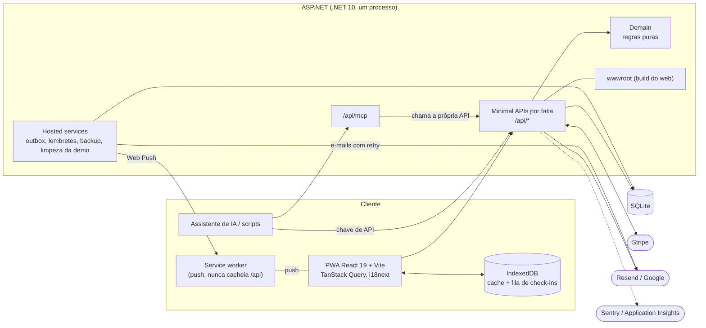

# Arco

App de hábitos com **progresso e objetivo**: check-ins diários alimentam hábitos com níveis, os hábitos servem a objetivos
com prazo e tudo vive em ciclos de 6 semanas, com XP e nível de jogador. PWA instalável, offline para o dia a dia,
multiusuário e operável inteiro pela API e por assistentes de IA via MCP.

- **Demo ao vivo:** https://arco.daviluis.dev (botão "Experimentar demo", sem cadastro)
<!-- Badge do Azure DevOps: ativar quando o pipeline existir (trocar ORG e PROJETO).
[](https://dev.azure.com/ORG/PROJETO/_build/latest?definitionId=1&branchName=main)
-->
- **API interativa (Scalar):** https://arco.daviluis.dev/api/docs · OpenAPI em `/api/openapi/v1.json`

| Hoje | Hábito | Ciclo |
|---|---|---|
|  |  |  |

| Hoje (mobile) | Perfil | Landing |
|---|---|---|
|  |  |  |

## Funcionalidades

- **Hábitos com níveis:** cada nível tem uma dose ("25 min") e uma versão mínima ("5 min"). Dá para planejar a
  escada à frente e escolher quando o app sugere subir e quando sugere voltar um degrau.
- **Check-in** Feito / Mínimo / Não fiz, com XP; sequências (streaks) com tolerância a uma falha isolada por semana.
- **Ciclos e objetivos:** ciclos de ~6 semanas com objetivos numéricos ou por marcos, e encerramento com revisão guiada.
- **Revisão semanal**, **conquistas**, **histórico**, **estatísticas** e sessões de **foco**.
- **Lembretes push** por hábito e da revisão semanal.
- **Offline:** telas com os últimos dados e fila de check-ins enviada quando a conexão volta.
- **Planos Free e Pro** com Stripe (limites de hábitos, chaves de API e MCP; temas do perfil no Pro).
- **Perfil público** em `/u/<slug>` com prévia social (imagem Open Graph gerada no servidor).
- **Parceiro de responsabilidade:** convite por link; o parceiro vê o resumo semanal e é avisado quando a semana fecha (push ou e-mail).
- **Conta:** e-mail e senha ou Google, 2FA (TOTP) com códigos de recuperação, sessões por aparelho, onboarding.
- **pt-BR e inglês** (app, e-mails e notificações).
- **Admin:** métricas agregadas (cadastros, ativos, retenção por coorte).
- **Backup** diário no servidor (14 dias) e exportação JSON no Perfil.
- **API e MCP:** tudo pela API REST com chave de API, mais um servidor MCP para assistentes de IA.

O conceito e as regras (XP, sugestões, sequências, planos) estão em [docs/PRODUCT.md](docs/PRODUCT.md).

## Arquitetura



## Stack

- **Backend:** .NET 10 (Minimal APIs organizadas em fatias, EF Core 10, SQLite), em `src/Arco.Api`.
- **Frontend:** React 19, Vite, TypeScript, TanStack Query, React Router 7, Tailwind v4, i18next e vite-plugin-pwa, em `web/`.
- **Integrações:** Stripe (cobrança), Resend (e-mail), Google OAuth, SkiaSharp (imagem OG) e Azure Service Bus (opcional).
- **Observabilidade e resiliência:** Sentry, OpenTelemetry com Application Insights e `Microsoft.Extensions.Http.Resilience`.
- **Infraestrutura:** Terraform (azurerm), Key Vault, GitHub Actions com OIDC e Azure DevOps (só build e testes).
- **Produção:** um único processo. O ASP.NET serve a API (`/api/*`) e o build do frontend (`wwwroot`).

```
src/Arco.Api/
  Domain/           regras puras e testáveis (XP, níveis, frequência, sequências, sugestões, conquistas)
  Features/<Nome>/  endpoint e lógica de cada funcionalidade (hábitos, check-ins, ciclos, MCP…)
  Infrastructure/   DbContext e migrations, relógio, autenticação (cookie e chave de API), push, backup,
                    outbox, eventos, resiliência e telemetria
tests/Arco.Api.Tests/  testes de domínio e de integração (WebApplicationFactory + SQLite temporário)
web/src/
  api/              cliente tipado, espelho de docs/API.md
  features/         lógica por domínio (check-in offline, hábitos, XP, estatísticas…)
  components/ui/    primitivas visuais
  pages/            telas (Hoje, Hábitos, Ciclo, Perfil, Estatísticas, Revisão, Login, Onboarding, Admin, Parceiro)
infra/              Terraform do Azure
docs/               produto, contrato da API e deploy
```

## Desenvolvimento

Requisitos: .NET 10 SDK e Node 24.

```bash
dotnet run --project src/Arco.Api    # API em http://localhost:5080
cd web && npm install && npm run dev  # app em http://localhost:5173 (proxy de /api para :5080)
```

- Crie uma conta em `/register` ou use "Experimentar demo". Sem `Email:ResendApiKey`, os e-mails saem no log da API.
- O service worker (offline e push) não roda no `npm run dev`. Para testar, use `npm run build && npm run preview`
  (http://localhost:4173, com o mesmo proxy).
- Se o `npm install` pular as devDependencies (por `NODE_ENV=production` na máquina), use `npm install --include=dev`.
- Os ícones do PWA saem de `web/public/icon*.svg`: `npm run icons` regera os PNGs.

Testes e verificação:

```bash
dotnet test                              # backend: domínio e integração
cd web && npm run lint && npm run build  # frontend: oxlint e build com checagem de tipos
cd web && npx playwright install chromium && npm run e2e   # E2E (Playwright)
cd web && npm run screenshots            # regera docs/images
```

Os testes de integração usam `WebApplicationFactory` com SQLite temporário e relógio controlável. O E2E publica a API
numa pasta temporária (porta 5199) e o preview do web (porta 4199); `E2E_API_PORT` e `E2E_WEB_PORT` trocam as portas, para
rodar execuções simultâneas.

Nova migration (aplicada sozinha na inicialização; se falhar, o app não sobe):

```bash
dotnet tool restore
dotnet tool run dotnet-ef migrations add <Nome> --project src/Arco.Api --output-dir Infrastructure/Migrations
```

Hash da senha de produção: `dotnet run --project src/Arco.Api -- hash-password "sua-senha"`.

## Decisões técnicas

- **Filtro global por usuário:** entidades `IUserOwned` têm filtro de query via `CurrentUser`; jobs de fundo usam
  `CurrentUser.Impersonate(id)` e `IgnoreQueryFilters()` só em leituras cruzadas intencionais. Esquecer um `Where` não vaza dados.
- **XP como livro-razão:** cada ação grava um `XpEvent` na mesma transação; excluir algo remove os eventos e revoga conquistas.
  O nível sai da soma, nunca de um contador.
- **Web Push sem dependência:** VAPID e criptografia `aes128gcm` implementados em `Infrastructure/Push`; os lembretes rodam num hosted service.
- **Offline com fila:** o cache do TanStack Query é persistido no IndexedDB e os check-ins pausam numa fila ordenada, retomada ao reabrir; o servidor recalcula o XP.
- **MCP:** `/api/mcp` expõe ferramentas que chamam a própria API REST (nunca o banco), então valem as mesmas regras e limites de plano.
- **TOTP próprio:** 2FA (RFC 6238) com segredo cifrado por DataProtection e códigos de recuperação guardados só como SHA-256, sem pacote externo.
- **Origem pública atrás do Cloudflare:** `App:BaseUrl` fixa a origem de toda requisição em produção, mantendo estáveis o redirect_uri do Google e os links dos e-mails.
- **Outbox transacional:** e-mails e eventos são gravados no mesmo `SaveChanges` da ação; um worker entrega com retry, backoff e lease, e o payload é apagado após o envio, porque pode conter token.
- **Resiliência por host:** retry, timeout e circuit breaker nos clientes de push e e-mail, com um circuito por host; 404/410 de push significam inscrição morta e nunca entram em retry.
- **Evento atrás de interface:** `WeekClosed` passa pelo `IEventBus`, em memória por padrão ou Azure Service Bus só com connection string; o consumidor é idempotente.
- **Dapper só em relatório:** as métricas do admin, que cruzam usuários de propósito, usam SQL com Dapper; o resto continua no EF para não perder o filtro por usuário.
- **Telemetria sem dados pessoais:** só liga com a connection string; query string, IP, user agent e texto de SQL são removidos antes de exportar.
- **Datas:** "hoje" vem do fuso do usuário, nunca de `DateTime.UtcNow`; datas de calendário são `DateOnly`.

## API e MCP

Tudo o que o app faz passa pela API REST documentada em [docs/API.md](docs/API.md). Fora do app, autentique com
uma chave de API, criada em **Perfil → Acesso pela API** (ela aparece uma única vez):

```bash
curl -H "Authorization: Bearer arco_..." https://arco.daviluis.dev/api/today
```

O servidor MCP fica em `/api/mcp`, com a mesma chave. Para conectar no Claude Code:

```bash
claude mcp add --transport http arco https://arco.daviluis.dev/api/mcp --header "Authorization: Bearer arco_..."
```

## Deploy

**Azure App Service (plano Free):** publicado em `https://arco.daviluis.dev` (proxy do domínio do Azure). A esteira do GitHub Actions testa e publica a cada push na `main`. A configuração
única (Web App, identidade OIDC, segredos), os limites do plano, o backup e o monitor de disponibilidade estão em
[docs/DEPLOY.md](docs/DEPLOY.md).

**Infraestrutura como código:** o ambiente do Azure está descrito em [`infra/`](infra/) com Terraform, com state remoto e segredos no Key
Vault (o código só guarda referências). O `apply` é sempre manual; cada pull request roda um `terraform plan`. O passo a passo está em
[infra/IMPORT.md](infra/IMPORT.md).

**Servidor próprio (Docker):** requer uma VPS com Docker e um domínio apontando para ela (HTTPS é obrigatório para o
PWA e o push).

1. Copie `.env.example` para `.env` e preencha `ARCO_DOMAIN`, `ARCO_PASSWORD_HASH` (entre aspas simples) e
   `ARCO_PUSH_SUBJECT`.
2. Rode `docker compose up -d --build`.

O Caddy emite o certificado. O banco, as cópias de backup e as chaves ficam no volume `arco-data` (`/data`). Para
copiar o banco à mão:

```bash
docker compose cp arco:/data/arco.db ./backup.db
```

## Documentação

- [docs/PRODUCT.md](docs/PRODUCT.md): conceito, regras, pendências e próximos passos.
- [docs/API.md](docs/API.md): contrato da API (mantido a cada mudança).
- [docs/DEPLOY.md](docs/DEPLOY.md): deploy no Azure, Stripe, Sentry, backup e restauração.
- [docs/repo_map.md](docs/repo_map.md): mapa do repositório.
- [docs/RELATO-AZURE.md](docs/RELATO-AZURE.md): como foi montar a esteira no Azure.
- [infra/IMPORT.md](infra/IMPORT.md): importar o ambiente para o Terraform.
- [CLAUDE.md](CLAUDE.md): convenções para quem (ou o que) mexe no código.
