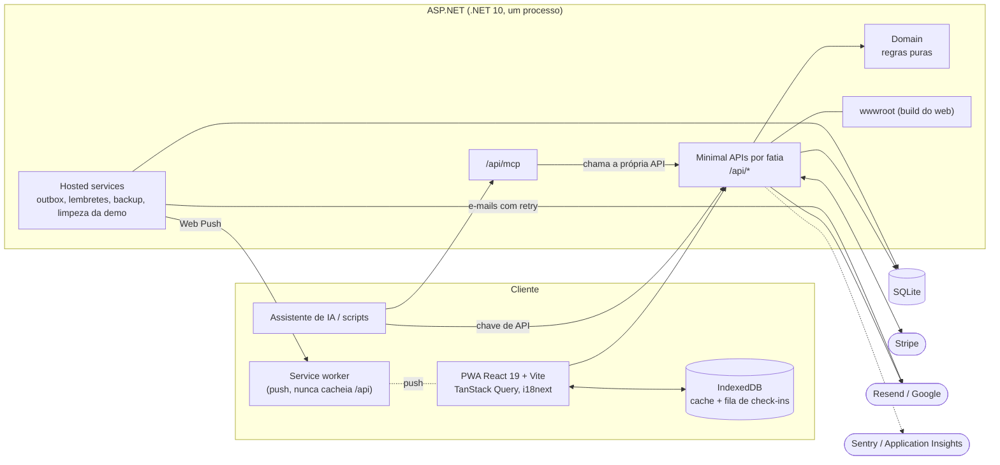
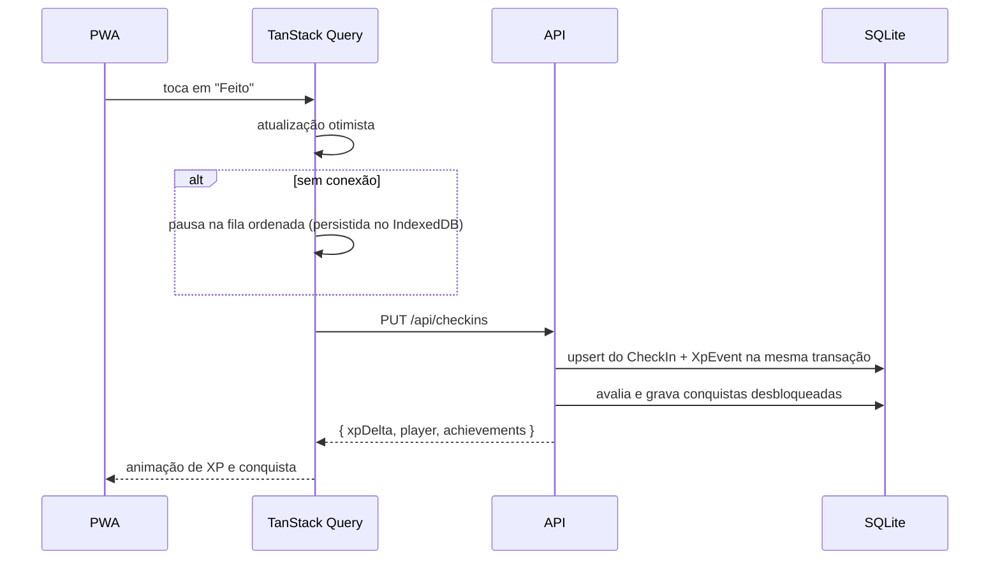
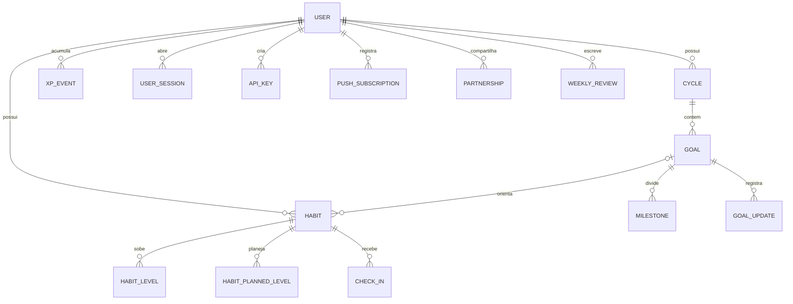

# Arco — Arquitetura

Detalhe técnico do que o [README](../README.md) resume: estrutura, segurança, confiabilidade, observabilidade,
offline e as decisões por trás de cada escolha.

## Arquitetura

O sistema é um **monólito modular**, em um único processo, de propósito: para o volume do projeto, um deploy simples e transações
locais valem mais do que a complexidade operacional de serviços distribuídos. As fronteiras internas, como `IEmailSender` e
`IPushSender`, permitem trocar implementações sem mudar as regras de negócio.

### Fluxo de um check-in

O XP é sempre recalculado no servidor, então um check-in reenviado pela fila não concede pontos em dobro: há um índice único por `(HabitId, Date)`.

### Modelo de dados (principais entidades)

Restrições importantes ficam no próprio banco: um **índice único parcial** garante no máximo um ciclo ativo por usuário, e índices
únicos evitam revisão semanal, lembrete ou check-in duplicados mesmo sob concorrência.

## Segurança

- **Isolamento entre contas:** entidades `IUserOwned` recebem um *global query filter* do EF Core, e novas linhas são carimbadas com o dono
  ao salvar. Esquecer um `Where` não vaza dados. `IgnoreQueryFilters()` só aparece em consultas intencionalmente globais.
- **Senhas:** bcrypt com fator de custo 11. O login verifica um hash fictício quando o e-mail não existe, para que o tempo de resposta não revele quais contas existem.
- **Sessões:** cookie `HttpOnly`, `Secure` e `SameSite=Lax`, ligado a uma linha em `UserSessions`. Isso permite listar aparelhos e encerrar
  sessões remotamente, e trocar a senha invalida as demais.
- **2FA:** TOTP (RFC 6238, HMAC-SHA1, 6 dígitos, janela de ±1 passo, cada código aceito uma única vez), com segredo cifrado por ASP.NET DataProtection e 10 códigos de recuperação guardados apenas como SHA-256.
- **Chaves de API:** exibidas uma única vez e guardadas só como SHA-256; ações sensíveis, como trocar a senha e excluir a conta, exigem o cookie.
- ***Rate limiting*:** janela fixa por IP, 5 tentativas de login e 10 ações de conta por minuto, respondendo `429` no formato padrão de erro.
  Em produção o IP vem de `CF-Connecting-IP` (`Proxy:ClientIpHeader`), que o cliente não consegue forjar.
- **Origem fechada:** o App Service só aceita os IPs do Cloudflare (regras de acesso no Terraform, padrão `Deny`); o host
  `*.azurewebsites.net` responde `403`, então não dá para contornar o proxy nem forjar `X-Forwarded-For`.
- **Stripe:** webhook com verificação de assinatura e deduplicação por `event.id` na mesma transação da mudança de plano.
- **Tokens de e-mail** (verificação e redefinição) são guardados apenas como hash.
- **Headers:** `X-Content-Type-Options: nosniff`, `X-Frame-Options: DENY` e `Referrer-Policy: strict-origin-when-cross-origin`.
- **Segredos de produção:** ficam no Azure Key Vault, lidos pela managed identity do App Service. O GitHub Actions autentica no Azure com
  *federated credentials* (OIDC), sem senha armazenada, e cada identidade tem o menor escopo necessário.
- **Repositório:** *secret scanning* com *push protection*, Dependabot, workflows com permissão só de leitura por padrão, aprovação
  manual para PRs de fora, `main` protegida contra force-push e exclusão, e o environment `production` restrito à `main`.
- **Relato de vulnerabilidades:** pelo canal privado do GitHub, conforme o [SECURITY.md](SECURITY.md).

## Confiabilidade

**Transactional outbox.** Enviar um e-mail depois de salvar no banco tem duas falhas clássicas: o e-mail sai e o `SaveChanges` falha, ou o
oposto. Aqui, a mensagem é gravada em `OutboxMessages` **na mesma transação** da ação, e a entrega acontece depois.

- E-mails são tentados logo após o `SaveChanges`, para o usuário não esperar; um *hosted service* varre o que ficou pendente a cada 30 s.
- *Claim* atômico com `UPDATE ... WHERE LockedUntil IS NULL OR LockedUntil < now` e *lease* de 5 minutos, que impede envio duplo.
- *Backoff* de 1 min, 5 min, 30 min, 2 h e 12 h, com desistência após 6 tentativas.
- O payload é apagado após o envio, porque pode conter o link de redefinição de senha. Os registros são removidos depois de 30 dias.
- O `Idempotency-Key` enviado ao Resend evita duplicidade se a resposta se perder depois de o e-mail ter sido aceito.

**Evento de domínio.** Concluir a revisão semanal grava `WeekClosed` no outbox; o worker entrega ao consumidor, que avisa cada
parceiro aceito, sem atrasar a resposta da revisão. A deduplicação usa uma chave única por parceiro e semana, tornando a reentrega segura (o outbox entrega *at-least-once*). Se o envio do push falhar, a marca é desfeita para a próxima tentativa avisar.

**Clientes HTTP resilientes.** Push e e-mail usam `AddStandardResilienceHandler` com timeout de 8 s por tentativa e 25 s no total, 3 retentativas
com *exponential backoff* e *jitter*, e um *circuit breaker* **por host** (janela de 60 s, mínimo de 8 chamadas, 50% de falha, 30 s aberto), já que FCM,
Apple e Mozilla falham de forma independente. Respostas 404/410 indicam inscrição morta: removem a inscrição, sem retentar nem contar para o circuito.

**Jobs de fundo** não têm `HttpContext`: cada usuário é processado em um escopo próprio com `CurrentUser.Impersonate(id)`, de modo que a falha de um não afeta os demais.

**Backup:** cópia diária com `VACUUM INTO`, consistente mesmo com o app em uso, com retenção de 14 dias.

## Observabilidade

- **Sentry** no backend e no React para erros, com `BeforeSend` removendo cookies, headers e outros dados da requisição.
- **OpenTelemetry com Application Insights:** ativado apenas com `APPLICATIONINSIGHTS_CONNECTION_STRING`. Traces de requisição, HttpClient e EF Core, além de
  spans próprios em lembretes e envio de e-mail.
- **Métricas de negócio:** `arco.checkins.created`, `arco.push.sent`, `arco.push.failed` e `arco.plan_limit.blocked`.
- **Privacidade por padrão:** um `BaseProcessor<Activity>` remove `url.query`, `client.address`, `user_agent.original`, `enduser.*` e o texto de SQL antes da exportação. A ausência desses dados foi conferida em consultas KQL sobre a telemetria de produção.

## PWA e offline

- O cache do TanStack Query é persistido no **IndexedDB**, e as telas abrem com os últimos dados sem rede. O service worker **nunca** cacheia `/api`, evitando duas fontes de verdade.
- **Check-in offline:** a mutação pausa sem rede, em uma fila ordenada por `scope`; ao reabrir o app, as mutações são retomadas na ordem. As demais ações usam `networkMode: 'always'` e falham na hora, com mensagem clara.
- O app distingue `isLoadingError` de `isError`, para que uma falha de atualização não substitua dados em cache por uma tela de erro.
- **Push:** VAPID e criptografia `aes128gcm` feitos sobre `System.Security.Cryptography`. Uma tabela de despacho com chave única garante no máximo um envio por lembrete, e inscrições com 10 falhas seguidas são removidas.
- Uma mudança incompatível no formato das respostas troca o `buster`, invalidando o cache persistido.

## Decisões técnicas

- **Filtro global por usuário:** entidades `IUserOwned` têm filtro de query via `CurrentUser`; jobs de fundo usam
  `CurrentUser.Impersonate(id)` e `IgnoreQueryFilters()` só em leituras cruzadas intencionais. Esquecer um `Where` não vaza dados.
- **XP como livro-razão:** cada ação grava um `XpEvent` na mesma transação; excluir algo remove os eventos e revoga conquistas.
  O nível sai da soma, nunca de um contador.
- **Web Push sem dependência:** VAPID e criptografia `aes128gcm` implementados em `Infrastructure/Push`; os lembretes rodam num hosted service.
- **Offline com fila:** o cache do TanStack Query é persistido no IndexedDB e os check-ins pausam numa fila ordenada, retomada ao reabrir; o servidor recalcula o XP.
- **MCP:** `/api/mcp` expõe ferramentas que chamam a própria API REST (nunca o banco), então valem as mesmas regras e limites de plano.
- **TOTP próprio:** 2FA (RFC 6238) com segredo cifrado por DataProtection e códigos de recuperação guardados só como SHA-256, sem pacote externo.
- **Origem pública atrás do Cloudflare:** `App:BaseUrl` fixa a origem de toda requisição em produção, mantendo estáveis o redirect_uri do Google e os links dos e-mails. A origem só aceita o Cloudflare, e o IP do cliente vem de `CF-Connecting-IP`.
- **Outbox transacional:** e-mails e eventos são gravados no mesmo `SaveChanges` da ação; um worker entrega com retry, backoff e lease, e o payload é apagado após o envio, porque pode conter token.
- **Resiliência por host:** retry, timeout e circuit breaker nos clientes de push e e-mail, com um circuito por host; 404/410 de push significam inscrição morta e nunca entram em retry.
- **Evento pelo outbox, sem broker:** `WeekClosed` vai do outbox direto ao consumidor, que é idempotente. Uma versão anterior tinha um `IEventBus` com Azure Service Bus opcional; foi removida, porque um evento com um consumidor no mesmo processo não justifica um broker.
- **Dapper só em relatório:** as métricas do admin, que cruzam usuários de propósito, usam SQL com Dapper; o resto continua no EF para não perder o filtro por usuário.
- **Telemetria sem dados pessoais:** só liga com a connection string; query string, IP, user agent e texto de SQL são removidos antes de exportar.
- **Datas:** "hoje" vem do fuso do usuário, nunca de `DateTime.UtcNow`; datas de calendário são `DateOnly`.
